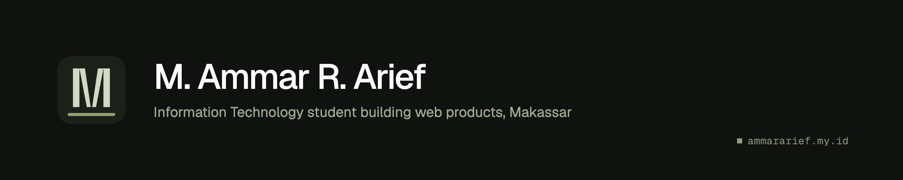

  

<h3>📚 About Me</h3>

- 🎓 Information Technology student in Makassar, South Sulawesi — building web products rather than exercises
- 🧑‍💻 Personal site is a working product, not a scrolling résumé: [ammararief.my.id](https://ammararief.my.id) — editorial layout, AI chat that answers from its own content, admin panel, Cloudflare Workers
- 🦀 Writing Rust to rewrite apps one piece at a time, each step checked against the original's recorded behaviour ([everything-rust](https://github.com/AmmarArief/everything-rust))
- 🛠️ Comfortable across the stack: TypeScript on the front, TanStack Start / Next.js and Cloudflare Workers behind it, Swift and Rust when the job needs a native binary
- 🖥️ Builds tools for the machine I actually work on — terminal supervision for AI agents ([agent-terminals](https://github.com/AmmarArief/agent-terminals)), a macOS port viewer ([ports-on](https://github.com/AmmarArief/ports-on))
- 🌱 Interested in product design, agent tooling, and local-first software; prefers small, boring, maintainable systems
- 📫 Reach me through [ammararief.my.id](https://ammararief.my.id) or open an issue on any repo below

 

<h3>🧰 Tech Garden</h3>

  
  
  
  
  
  
  
  
  
  
  
  
  
  
  

<h3>🌿 Activity</h3>

<table align="center">
  <tr>
    <td width="49%" valign="top">
      
    </td>
    <td width="2%"></td>
    <td width="49%" valign="top">
      
    </td>
  </tr>
  <tr>
    <td colspan="3" align="center">
      
    </td>
  </tr>
</table>

  Makassar, Indonesia · <a href="https://ammararief.my.id">ammararief.my.id</a>

